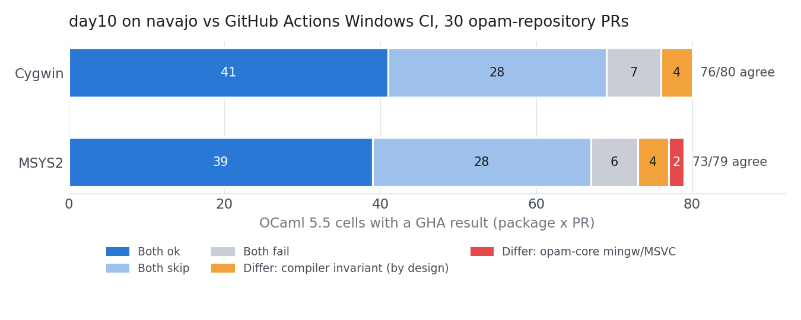

`day10` builds Windows packages again and agrees with GitHub Actions on all but a handful of explainable cells; OCaml 5 has been killed by Ctrl-Break since 2022; opam 2.6 reached every CI; a page cache saved 0.64 seconds; and one CephFS metadata server was doing all the work.

# `day10`

## Windows is back

The Windows backend hadn't been run in months, and after the recent Linux work to improve teardown from cancelled jobs, it didn't start at all.

The cleanup code used `Sys.signal` to catch SIGHUP and SIGPIPE, which raise an exception on Windows. `OpamStd.Sys.uname` is Unix-only (still true in opam 2.6.1), the colon in `c:\opam-repository` was parsed as the `path:rev` separator, the `hcn-namespace` helper needs `libffi-6.dll`, and `ctr` escapes quotes, so `set "PATH=..."` never ran.

Testing on Windows Server 2025, `day10 health-check uutf.1.0.4` was the first success, building the base and 14 layers. `day10-install` 1.4.0 is released with Windows and FreeBSD assets.

Looking at the first fixes, it was clear that the boundary between what was OS specific has become blurred. `main.ml` included things like `sudo rm`. The differentiator had been `S.CONTAINER` for `runc` vs `jails` vs HCS, but this was reworked into `S.PLATFORM`, which then added the OS specific functions. This took a couple of iterations trying some common functions in `posix.ml`, which I later discarded.

## A symlink a container can't execute

`praxo-core` failed on 5.5.2. Since OCaml 5.4 ([ocaml/ocaml#13494](https://github.com/ocaml/ocaml/pull/13494)), `flexlink.exe` in `opt/bin` is a relative symlink rather than a copy, and a Windows container cannot execute a relative symlink on a bind mount. `mklink` alone reproduces it, on NTFS and ReFS.

The first workaround was to build as a non-admin `opam` user, so OCaml's configure falls back to `cp -pf`. That needed `CopyFileW` for layer copies, since Cygwin's fallback symlinks depend on the SYSTEM attribute and a byte copy dropped it, which broke `awk` in `why3`'s configure. It worked, but it was a pile of workarounds.

Clearing attributes, an NTFS backing filesystem and enabling every `SymlinkEvaluation` option on the host made no difference, nor did a different Windows build on navajo. HCS ignores the lower layer when stacking sibling layers, so native container layers were out.

Instead, the entire cache is now mounted read-only, and the layers are assembled inside the container: `robocopy` moves 1.3 GB in 2.7 s, compared to 3.9 s for a host ReFS block clone. Results are copied out by archive bit. That deleted `copy_tree`, `hardlink_tree`, `CopyFileW` and the ctypes dependency (594602a), and builds run as ContainerAdministrator again, with `flexlink` a native symlink.

At the same time as the above layer changes, I had been adding MSYS2 as `--os-distribution msys2`, which reinforced the issues as working on a bind mount: pacman cannot replace its own binaries, `gpg-agent` held the container open, and an empty CA bundle was generated. A 20-job matrix of zarith, sqlite3, lwt, uutf and ppxlib on Cygwin and MSYS2 with 4.14.4 and 5.5.2 all passed.

`windows.ml` now differentiates between `cygwin.ml` and `msys2.ml` as `S.UNIX_LAYER`.

## navajo becomes the `day10` Windows worker

navajo was reinstalled with a single Windows guest, 200 GB of RAM, and 16 jobs, serving the `day10-windows-x86_64` pool. Running the worker as a Windows service needed patches: there is no console, so `day10` died silently; Cygwin's DACLs blocked deletes; and the SIGTERM used to cancel a job crashed the service. Lwt on Windows resolves `FD_copy stdout` in the parent, so `day10`'s `[NOTE]` and `[ERROR]` lines went to the worker's log rather than the job log.

## Smaller fixes

By design, `ctr` exits with "All pipe instances are busy" when containerd is loaded. `day10` now retries only that error, up to 60 times. The old code retried only `snapshot prepare` ten times on any error and then parsed an empty `mounts.json`. `day10` also kept building on a failed base while the job reported success. It now stops and keeps no base, on every platform.

## FreeBSD

With Windows now working again, and the changes currently in mind, I updated the FreeBSD code to address the same changes there. Additionally, `opam` reports the family as `bsd`, so 128 filters in the opam-repository were evaluated as false. The arch was `amd64`, where opam says `x86_64`.

`bsdinstall script` was hanging on 15.1 (replaced with fetching `base.txz`, checking it against the MANIFEST and untarring). The base installation is now step-by-step and follows `--os-version`, so 1501000 becomes 15.1-RELEASE. 14.3 has gone from the mirror; 14.5 built to 14.5-RELEASE-p3.

## Trusting the solution for depexts

Last week's `prune --depexts` needs to know which layers installed system packages. The Windows implementation compared a layer against whichever base was present now, so a rebase would have pruned everything. The second attempt recorded a flag via a probe of the tree, with probe-on-first-sight as the migration path for old layers. The third attempt added a field to `layer.json` derived from the solution's depexts. The existing layers were updated with a one-off script.

The migration updated about 460,000 layer records in under two minutes, 296,000 of them on doris. The first automatic base replacement ran on 5 November: doris removed 15 bases and pruned 820 depext layers, okypous 12 and 426, orithia 7 and 227. Doris had remade 12 bases within the hour.

## Checking `day10` against GitHub Actions

opam-repository runs Windows tests in GitHub Actions on Cygwin and MSYS2. I took 53 open PRs at fixed SHAs, 572 cells across both environments and OCaml 4.14.4 and 5.5, and ran them on navajo. 30 PRs had a GHA result to compare with.

*OCaml 5.5 cells where both systems produced a result*

Cygwin matched on 76 of 80 and MSYS2 on 73 of 79. The four compiler packages in #31117 differ in design: `day10` builds them with `--update-invariant`, whereas GHA's switch is locked to 5.5.2 and skips them.

The other two, `opam-audit` and `dune-release` on MSYS2, I initially took for a `day10` solver bug, but they are opam-repository metadata issues. `opam-core`'s mingw branch needs both the i686 and x86_64 toolchains, and on MSYS2 these pull in `msys2-mingw32` and `msys2-mingw64`, which share a conflict class. The only solution is the MSVC branch. GHA passes because the runner has Visual Studio installed, and it ends up with a mingw compiler marked as `host-system-msvc`. GHA succeeds only by not building what it was asked to build.

On three new PRs, `day10` was 2-30 times faster than GHA, but mostly because its cache was warm. GHA spends 95 to 773 seconds on setup before testing anything.

## OCaml's Ctrl-Break

While working on job cancellation, I found that OCaml 5 processes are killed by Ctrl-Break even with a SIGINT handler installed. [ocaml/ocaml#10898](https://github.com/ocaml/ocaml/pull/10898) dropped the `#define` which routed `signal()` to `caml_win32_signal`.

| | Ctrl-C | Ctrl-Break |
|---|---|---|
| 4.14.2 | handled | handled |
| 5.3.0 | handled | killed |
| trunk | handled | killed |
| trunk + PR | handled | handled |

[ocaml/ocaml#15267](https://github.com/ocaml/ocaml/pull/15267) restores it with a test in `tests/lib-sys`. MSVC builds failed on the test's use of `ShowWindow` from user32, which is now looked up at runtime. nojb merged it on Saturday, and it will be in 5.6; until then, `day10` needs a small C stub, built with dune's `foreign_stubs`, to hook this signal.

## basil joins the obuilder pool

Basil was reinstalled with two 7.3 TB volumes, each with an 830 GiB writeback dm-cache on SSD, running ltsc2025-5 and -6 with 20 vCPUs each, one per NUMA node. This takes the obuilder Windows pool from 16 slots to 24.

I based the new configuration on metrics from the 444 Windows jobs over the last two weeks. Build time follows the OBuilder cache hit rate: ltsc2025-4 hit 77% with a 10-minute median, while the others hit 46-48% with 40-96 minute medians. Four concurrent builds are no slower than one, and the median queue wait was six hours at 5.9% utilisation, because work arrives in bursts. Fewer workers with large disks are better; whether those disks are spinning disk or SSD made little difference.

The windows_worker changes from `run.sh` to systemd units, so VMs survive a host reboot and stop via the ACPI power button.

## The FsDepends leak

ltsc2025-1 had an impressive run of 54 days but ended up unable to start a new container with `CreateComputeSystem ... Insufficient system resources`. It had 13,320 `FsDepends` minifilter instances, 13,316 of them detached, plus 4,861 `bindflt` instances, and 10.3 GB of kernel nonpaged pool. A reboot brought the pool back to 129 MB.

A probe now records the instance counts every ten minutes. ltsc2025-2 sat at 5-7 for 30 hours and then started climbing. Across the machines, it starts after 88-262 builds or 2.1-3.2 days, and I can't yet separate the two. The mechanism is unknown.

# Other CI work

## opam 2.6

ocaml-ci's first attempt passed `--cli=2.6`, which opam 2.6.0 and 2.6.1 reject even though `--help` lists it as the default: `supported_versions` was never extended. That's [ocaml/opam#7229](https://github.com/ocaml/opam/pull/7229), and ocaml-ci now omits `--cli` for 2.6.

On macOS, the `opam-vars` jobs then failed because `opam-2.6` didn't exist, blocking all macOS dispatch, so every worker's base images were rebuilt. Apple Silicon took 30-97 minutes per worker; Intel took two to four hours. 

FreeBSD ([ocurrent/freebsd-infra#29](https://github.com/ocurrent/freebsd-infra/pull/29)) and OpenBSD ([ocurrent/obuilder#223](https://github.com/ocurrent/obuilder/pull/223)) have opam 2.6.1 and OCaml 5.5.2, and opam-repo-ci tests opam 2.6 ([#491](https://github.com/ocurrent/opam-repo-ci/pull/491)). After the opam-repo-ci redeploy, the new urgent 2.6 jobs sat behind about 5,000 urgent dune 3.25 alpha revdeps, so commit pages showed "Testing in progress" with nothing running.

## macOS ZFS

There was a recurrence of the ZFS corruption on 3 out of the 4 macOS workers, with only m1-worker-02 surviving. Somewhat embarrassingly, I'd been updating macFUSE in the belief that it was the only version at play, but actually the OpenZFS package is completely separate and needs to be updated separately, and its version is not reported in the System Preferences dialogue. Upgrading from 2.2.2 to 2.4.1p1 seems to have fixed the ZFS corruption. Interestingly, it's an Apple Silicon problem, as the Intel machines aren't affected.

## One list of opam versions

Each opam release meant edits in ocaml-dockerfile, docker-base-images, ocaml-ci and opam-repo-ci. [ocurrent/ocaml-dockerfile#277](https://github.com/ocurrent/ocaml-dockerfile/pull/277) makes `Dockerfile_opam.Opam_version` a closed variant, and the Docker base image builder and both CIs take it from there. Released as 8.4.7 alongside Fedora 45 ([#278](https://github.com/ocurrent/ocaml-dockerfile/pull/278)). openSUSE Leap 16.1 ([#279](https://github.com/ocurrent/ocaml-dockerfile/pull/279)) and the docker-base-images update ([#363](https://github.com/ocurrent/docker-base-images/pull/363)) are open.

## Intel macOS leaves OCaml-CI

Homebrew 7 no longer publishes Intel bottles, so every depext builds from source, and upstream OCaml has moved Intel macOS to Tier 2. [ocurrent/ocaml-ci#1079](https://github.com/ocurrent/ocaml-ci/pull/1079) drops it; it was merged and live on Tuesday. opam-repo-ci still uses the Intel workers, which now sit at 4-9% occupancy.

## A cache that saved 0.64 seconds

The scrapers hitting opam-repo-ci led me to implement the proof-of-work challenge page, but I never merged the commit because I wasn't really sure it was the right solution. Shon mentioned it too, as he ended up needing headless Chromium in order to solve the JS challenge. The idea which followed was that the commit summary page is the expensive one: up to 333,482 variants and over 60 MB of HTML, so could that be cached? I added an in-process cache with single-flight, short TTLs for busy commits and validation on each hit for settled ones ([#492](https://github.com/ocurrent/opam-repo-ci/pull/492)).

After 26 hours with the proof-of-work challenge still on, there had been 97 commit views and 1 real cache hit. So I removed the PoW challenge. A crawl started within a minute, peaking at 37 requests/s from 511 distinct IPs in 30 seconds, about one IP per request, which makes per-IP rate limiting useless. It was walking the menhir release commit with 21,214 variants, consuming about 2% of an engine CPU. As I had said before, you can't stop the scrapers; you just need to make it cheap.

After 30 hours and 39,500 requests, the cache had served 6 of 161 summary pages and saved 0.64 s. The real fix was [#482](https://github.com/ocurrent/opam-repo-ci/pull/482) in August, which changed a `LIKE` to a `GLOB` so that commit lookups use the primary key, taking them from 968 ms to about 1 ms.

However, I was still slightly annoyed that the scrapers were wasting resources pulling these logs. Spotting a pattern in the URLs and realising that Caddy can group similar URLs together with a rate limit, Caddy now limits requests for a specific commit to 5 per second. Additionally, unknown commits return 404 rather than 500 ([#493](https://github.com/ocurrent/opam-repo-ci/pull/493)), as about 6% of variant requests were for commits that aren't in the index. #492 and the proof-of-work PRs are closed.

# Tessera

## Greenland, continued

The EPFL run is 536 of 1,122 items through. 2017 finished on 4 November with 294 of 298 shards. 2019 is at 242 of 412, and 2023 hasn't started. At 50-100 uploads a day, there's about another week to go.

# Cambridge machines

## CVE follow-up

After 36 hours, the drop counters were zero on all 88 hosts with the filter. Red Hat's rating has since moved to Critical 9.8, and it now says that disabling MPTCP alone is not enough; the nftables rule is the part that matters. Ubuntu's fixed kernels reached `-updates` on 5-6 November, but no host has installed them, as unattended-upgrades only reads `-security`. The rolling upgrade, reboot, and filter removal are planned but not yet done; the RISC-V boxes on Scaleway's 5.10 and 20.04 hosts will keep the filter.

## CephFS: one MDS doing all the work

sherwood hung on Wednesday, thrashing without an OOM kill, and was reset via IPMI. When it came back, I applied the HWE 7.0 kernel. The "slow shared filesystem" was a single CPU-bound MDS: rank 0 had 42 GB RSS against a 32 GB cache limit and 29 million strays, while rank 1 sat idle. The balancer is off by default in Squid. Pinning the maps subvolume to rank 1 took about two hours to migrate, during which it got worse, and then 0.04 s on all three hosts.

## winter and okavango

winter went from 22.04 to 26.04 in two hops. The 6.8 reboot lost the network because `eno1` became `eno1np0`; it was fixed via the serial console with a netplan configuration matched to the MAC address. 15 of 21 accounts, unused for a year, are locked.

okavango went from 24.04 to 26.04 to 26.10, and is now on 7.3.0-10 with all three pools online.

## monteverde

`nvme.sgl_threshold=0` isn't the whole answer. The drive's error log went from 24,818 to 24,896 in 20 hours, about one rejection a minute. The kernel retries silently, and the same command then succeeds, which points to the firmware. Dell's two firmware packages contain the same 1.1.0 image, and the newer releases are for U.2 only, so I've requested a proactive replacement for the surviving drive.

# Other

## conservation-copilot

Ahead of a 26-person workshop, I ran a load test with six concurrent queries: 57 queries in three bursts with no failures. The R timeout fired three times, and each query recovered. Peak memory usage was 7.3 GB out of 7.9 GB.

## ocluster-top

[mtelvers/ocluster-top](https://github.com/mtelvers/ocluster-top) is a small `top`-style terminal UI for the OCluster scheduler. It uses the same admin API as `ocluster-admin` and shows the pools, busiest first, with the selected pool's workers and backlog below. Workers can be paused, drained, updated and forgotten from there.
